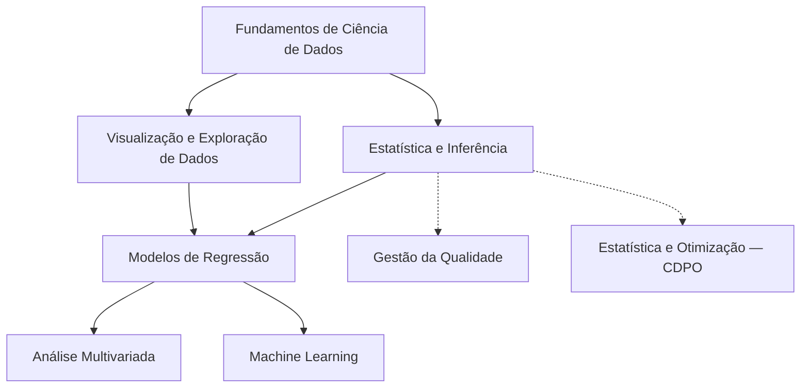

# Ciência de Dados com a Profa. Cibele Russo

**Oito trilhas gratuitas para estudar as aulas do ICMC/USP: do método científico e do Python até a inferência, a regressão e o aprendizado de máquina.**

!!! success "Material autorizado pela Profa. Cibele Russo (ICMC/USP)"

    Publicação autorizada em 15/10/2026. O material é público e gratuito, para estudo.
    Os vídeos continuam no canal da professora e aqui aparecem só como link.

## Mapa de estudo

A ordem sugerida segue as setas. Visualização caminha junto com Estatística e Inferência. Análise Multivariada e Machine Learning fecham a trilha principal, depois dos modelos de regressão. Gestão da Qualidade e CDPO ficam em paralelo, saindo da inferência.

## Trilhas

Cada card abre a página da trilha: roteiro vídeo, aula, slides e exercícios, links dos vídeos, guia de aulas, download do PDF e prévia dos slides.

-   🐍 **Fundamentos de Ciência de Dados**

    ---

    19 vídeos. Método científico, Python, NumPy/Pandas, EDA, KNN, árvores e validação.

    [Abrir trilha](materias/fundamentos-de-ciencia-de-dados/index.md)

-   📊 **Estatística e Inferência**

    ---

    47 vídeos. Exploração de dados, probabilidade, estimação, intervalos e testes de hipóteses.

    [Abrir trilha](materias/estatistica-e-inferencia/index.md)

-   🎨 **Visualização e Exploração de Dados**

    ---

    35 vídeos. Gráficos em R e Python, correlação, curva de Lorenz e EDA.

    [Abrir trilha](materias/visualizacao-e-exploracao-de-dados/index.md)

-   📈 **Modelos de Regressão**

    ---

    27 vídeos. Regressão linear simples e múltipla, modelo linear geral, ANOVA e MLG.

    [Abrir trilha](materias/modelos-de-regressao/index.md)

-   🧭 **Análise Multivariada**

    ---

    36 vídeos. Normal multivariada, Hotelling, MANOVA, PCA, agrupamentos e LDA.

    [Abrir trilha](materias/analise-multivariada/index.md)

-   🤖 **Machine Learning**

    ---

    11 vídeos. Classificação, métricas, ROC, KNN, logística, Naive Bayes e redes neurais.

    [Abrir trilha](materias/machine-learning/index.md)

-   🏭 **Gestão da Qualidade**

    ---

    37 vídeos. Trilha em paralelo: controle estatístico de processos, gráficos de controle e capacidade.

    [Abrir trilha](materias/gestao-da-qualidade/index.md)

-   ⚙️ **Estatística e Otimização (CDPO)**

    ---

    8 vídeos. Trilha em paralelo: estatística e otimização para ciência de dados e pesquisa operacional.

    [Abrir trilha](materias/estatistica-e-otimizacao-cdpo/index.md)

As oito trilhas cobrem 220 vídeos. Outros 11, de palestras e eventos, estão no [catálogo completo](catalogo/index.md), que reúne os 231 vídeos do canal.

Para ir aos canais oficiais da professora, abra [Aprofundar](aprofundar.md). Autoria, licença e o aviso sobre os resumos estão em [Sobre](sobre.md).
